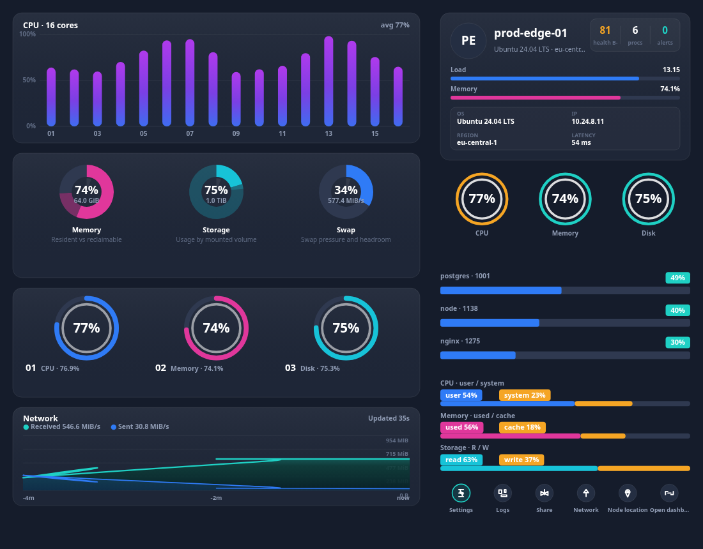

# Widgets

<div align="center">

**A collection of cross-platform UI widgets that read live data from the network.**

One codebase → web, Windows, Android, iOS. Canvas-rendered, framework-free, accessibility-aware.



<sub>Widgets: <code>&lt;server-monitor&gt;</code> — server resource dashboard (<a href="docs/images/server-monitor-light.png">light</a>, <a href="docs/images/server-monitor-mobile.png">single column</a>) · <code>&lt;log-stream&gt;</code> — virtualised log viewer (<a href="docs/images/log-stream-burst.png">incident burst</a>, <a href="docs/images/log-stream-mobile.png">mobile</a>) · <code>&lt;container-grid&gt;</code> — pod/workload fleet (<a href="docs/images/container-grid-mobile.png">mobile</a>)</sub>

</div>

---

## Why this exists

Dashboards usually get rewritten once per platform: a React app for the web, a XAML view for
Windows, a Compose screen for Android and a SwiftUI view for iOS. This repository takes the
other route — **one widget implementation, four+ host environments**:

| Layer | Package | Runs on |
| --- | --- | --- |
| Data + domain logic | [`@widgets/core`](packages/core) | Node, browser, React Native, native bridges (no DOM access) |
| Shared canvas kit | [`@widgets/render`](packages/render) | any renderer: geometry, hit-testing, glyphs, primitives, a test canvas double |
| Widgets (rendering + interaction) | [`@widgets/server-monitor`](packages/server-monitor) · [`@widgets/log-stream`](packages/log-stream) · [`@widgets/container-grid`](packages/container-grid) | `<server-monitor>` / `<log-stream>` / `<container-grid>` web components, canvas 2D |
| Native hosts | [`platforms/`](platforms) | WinUI/WebView2, Android WebView, WKWebView, React Native, Flutter |

Because the visual layer is a **web component painted on canvas inside a WebView**, every host
gets identical pixels, identical animations and identical interaction semantics — while the data
layer stays transport-agnostic (`WebSocket`, `SSE`, HTTP polling, or a snapshot pushed by native code).

## Features

- **Three widgets, one platform** — `<server-monitor>` (CPU / memory / disk / network dashboard), `<log-stream>` (virtualised log viewer with severity filtering) and `<container-grid>` (responsive pod/workload fleet with capacity rollups).
- **Live by design** — WebSocket, Server-Sent Events, HTTP polling and in-process mock streams behind one interface.
- **Self-healing connections** — exponential backoff with jitter, heartbeats, visibility-aware polling, control-frame suppression.
- **Tolerant ingestion** — accepts canonical snapshots *or* flat/snake_case payloads (`cpu_usage`, `memory_total`, `severity`, `msg`, `container`, Kubernetes `items` with quantity strings …) and refuses control frames that would blank a view.
- **Real monitoring semantics** — rolling history buffers, per-metric thresholds, health score + letter grade, derived alerts, log level/service counters, repeat collapsing, container health transitions and CPU sparklines.
- **Built for volume** — only the rows/cards inside the viewport are painted (row-based virtualisation everywhere) and the stores are bounded, so 400 workloads or 100k log lines stay smooth.
- **Designed, not default-styled** — a full design-token system (dark + light) mapped from the reference mock-up: gradient capsules, donuts, radial gauges, monotone-cubic area chart, status rings, severity rails, capacity bars and cards.
- **Responsive layout engine** — two columns above the breakpoint, single column below, sections dropped by priority when height is scarce (pure maths, unit-tested).
- **Accessible & keyboard operable** — canvas exposed via `role="img"`/`role="log"`/`role="grid"` + live regions, arrow-key navigation (2D in the grid), `/` to search, space to pause the log tail.
- **Zero runtime dependencies** — no chart library, no framework, ~76 KB minified IIFE per widget including the data layer.
- **Tested** — 185 unit tests over transports, normalisation, metric/log/container stores, geometry, layouts, virtualisation, view models, renderers and element lifecycles.

## Quick start

```bash
npm install

# terminal 1 — synthetic metrics server (HTTP + SSE + WebSocket)
npm run mock

# terminal 2 — interactive playground
npm run demo          # → http://127.0.0.1:5173
```

The playground needs no backend at all: pick **Mock (in-process)** as the data source and the
widget streams synthetic-but-realistic metrics.

### Use it in a page

```html
<script type="module" src="./server-monitor.global.js"></script>
<server-monitor src="wss://metrics.example.com/stream" transport="websocket" theme="dark"></server-monitor>

<script type="module" src="./log-stream.global.js"></script>
<log-stream src="wss://logs.example.com/stream" transport="websocket" level="warn"></log-stream>
```

### Use it from code

```ts
import { defineServerMonitor } from '@widgets/server-monitor';
import { defineLogStream } from '@widgets/log-stream';

defineServerMonitor();
defineLogStream();

const dashboard = document.createElement('server-monitor');
dashboard.style.cssText = 'display:block;width:100%;height:820px';
dashboard.setConfig({
  source: { transport: 'websocket', url: 'wss://metrics.example.com/stream' },
  theme: 'dark',
  thresholds: { cpu: { warning: 65, critical: 85 }, disk: { warning: 78, critical: 90 } },
  onAction: (action, payload) => console.log(action, payload),
});

const viewer = document.createElement('log-stream');
viewer.style.cssText = 'display:block;width:100%;height:640px';
viewer.setConfig({
  source: { transport: 'websocket', url: 'wss://logs.example.com/stream' },
  filters: { level: undefined, levels: [], services: [], query: '', minLevel: 'warn' },
  follow: true,
  onError: (error) => console.warn(error),
});

document.body.append(dashboard, viewer);
```

### Push data from a native host

```js
// Inside the WebView, after the bundle has loaded:
window.__widgets = document.querySelector('server-monitor');
window.__widgets.setSnapshot(snapshotFromNative);   // metrics pipeline

const logs = document.querySelector('log-stream');
logs.appendBatch({ timestamp: Date.now(), entries }); // log pipeline
```

## Repository layout

```
packages/
  core/                @widgets/core — contracts, transports, stores, thresholds, formatting, tokens, i18n, source resolution
  render/              @widgets/render — shared canvas kit: geometry, hit regions, glyphs, primitives, test canvas double
  server-monitor/      @widgets/server-monitor — <server-monitor> element, layout engine, canvas renderers
  log-stream/          @widgets/log-stream — <log-stream> element, virtualised list, filters, histogram, inspector
  container-grid/      @widgets/container-grid — <container-grid> element, card grid, capacity rollups, inspector
apps/
  mock-server/         synthetic metrics, logs and container fleets over HTTP / SSE / WebSocket
  demo/                Vite playground (widget tabs, source switch, theme, locale, section toggles)
platforms/             web · windows · android · ios · react-native · flutter host shells
scripts/               bundle smoke test for the shipped IIFE artifacts
docs/                  architecture, design system, embedding and widget-authoring guides
```

## Scripts

| Command | Description |
| --- | --- |
| `npm run build` | Builds `core` → `render` → the three widget packages (ESM + dts + IIFE bundles). |
| `npm test` | Runs the full Vitest suite. |
| `npm run typecheck` | Type-checks every package and app. |
| `npm run mock` | Starts the synthetic data server on `:4310` (metrics, logs, containers). |
| `npm run demo` | Starts the Vite playground on `:5173`. |
| `node scripts/serve-bundle.mjs --widget logs` | Serves a shipped bundle with a harness (bundle smoke test). |

## Documentation

- [Architecture](docs/architecture.md) — layers, data flow, contracts, why canvas inside a WebView.
- [Design system](docs/design-system.md) — tokens, section anatomy, chart vocabulary, responsiveness.
- [Embedding guide](docs/embedding.md) — web, Windows, Android, iOS, React Native, Flutter.
- [Authoring a new widget](docs/widget-authoring.md) — how to add widget #2 on top of the existing core.

## Roadmap

- [x] `server-monitor` — CPU / memory / disk / network dashboard
- [x] `log-stream` — live log tail with severity filters
  - [x] data layer: `LogEntry` contracts, tolerant normalisation, bounded `LogStore` with level/service counters, de-duplication and a rolling histogram
  - [x] widget: virtualised list, severity/service filters, search, detail inspector, stats
- [x] `container-grid` — Kubernetes pod / service health cards
  - [x] data layer: `ContainerInfo` contracts, Kubernetes `items`/quantity normalisation, `ContainerStore` with health transitions, sparkline history and capacity rollups
  - [x] widget: responsive card grid, phase/namespace/attention filters, 2D keyboard navigation, inspector, capacity + namespace analytics
- [ ] `uptime-timeline` — incidents and SLA heatmap
- [ ] Native renderers (Compose / SwiftUI) reusing `buildViewModel()` / `buildLogViewModel()` / `buildContainerGridViewModel()`
- [x] Platform work: shared canvas kit extracted to `@widgets/render`, transports and source resolution generalised over any snapshot type

## License

[MIT](LICENSE) © Arsin Shaabani

