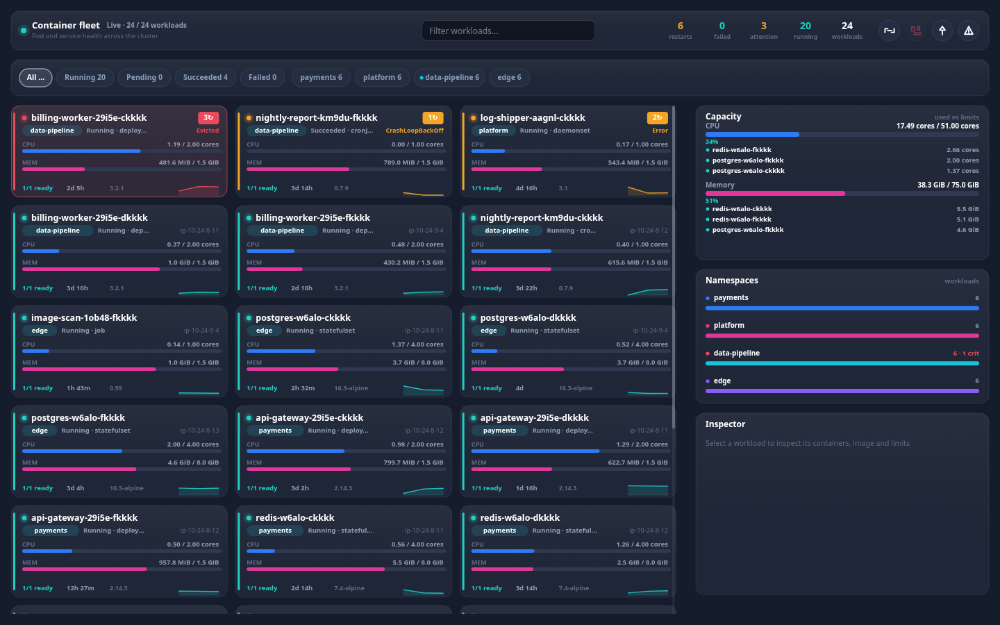

# @widgets/container-grid

Responsive pod/workload fleet grid packaged as the `<container-grid>` web component. Canvas
rendered, so the identical view runs on the web, in a Windows WebView2 shell, inside an Android
WebView, in a WKWebView, in React Native and in Flutter.

<p>
  
</p>

## Install & register

```bash
npm install @widgets/container-grid @widgets/core @widgets/render
```

```ts
import '@widgets/container-grid/auto';         // registers <container-grid> (+ <widgets-container-grid>)
// or
import { defineContainerGrid } from '@widgets/container-grid';
defineContainerGrid();
```

```html
<!-- one file, no build step, for WebView hosts -->
<script src="./container-grid.global.js"></script>
<container-grid src="wss://k8s.example.com/stream" transport="websocket" sort="severity"></container-grid>
```

## Configure

```ts
const fleet = document.querySelector('container-grid');

fleet.setConfig({
  // any of: DataTransport · URL · { transport, url, … } · ContainerSnapshot · getter · null (mock)
  source: { transport: 'websocket', url: 'wss://k8s.example.com/stream' },
  theme: 'dark',
  locale: 'en',
  cardMinWidth: 246,      // the grid fits as many columns as the width allows
  cardHeight: 132,
  cardGap: 12,
  maxContainers: 400,     // bounded fleet (healthiest dropped first)
  historySize: 24,        // sparkline samples per card
  sort: 'severity',       // severity | name | restarts | cpu | memory
  filters: { phases: ['failed', 'pending'], namespaces: [], query: '', attentionOnly: false },
  sections: { namespaces: false, capacity: true },
  searchable: true,       // renders a real <input> for the search box
  onAction: (action, payload) => openRunbook(action, payload),
  onError: (error) => report(error),
});
```

Attributes cover the declarative cases:

```html
<container-grid
  src="wss://k8s.example.com/stream"
  transport="websocket"
  theme="dark"
  locale="en"
  phase="failed,pending"
  namespace="payments,edge"
  query="api-gateway"
  attention="true"
  sort="restarts"
  columns="2"
></container-grid>
```

## API

| Member | Description |
| --- | --- |
| `setConfig(config)` | patch the configuration (restarts the source only when `source` changes) |
| `appendBatch(snapshot)` | push a fleet snapshot from a native bridge or your own data layer |
| `filter` (get/set) | read or update the active phase/namespace/query/attention filter |
| `selectedId` | id of the inspected workload |
| `copyState()` | copies the filtered fleet state as newline separated text |
| `clear()` / `refresh()` / `stop()` / `start()` | buffer and transport control |
| `containerCount`, `viewModel`, `currentLayout`, `hitRegions` | last frame's state |
| events | `widget-snapshot`, `widget-transition`, `widget-select`, `widget-action`, `widget-error`, `widget-render` |

## Interaction

| Input | Behaviour |
| --- | --- |
| wheel / drag | scroll the virtualised grid |
| click a card | inspect it in the side panel |
| click a phase/namespace chip | toggle that filter; `All` resets |
| `←` `→` | move the selection by one card |
| `↑` `↓` | move by one grid row |
| `PageUp` `PageDown` `Home` `End` | page/jump through the fleet |
| `a` | toggle "needs attention" |
| `/` | focus the search field |
| `Esc` | clear the selection |

## Sections

`toolbar` · `filters` (full width) then `grid` (left column) and `capacity` · `namespaces` ·
`detail` (right column). Any section can be hidden with `config.sections`, and the layout engine
re-flows the rest.

## Payload shapes it understands

```jsonc
// canonical batch
{ "containers": [{ "name": "api-7d9f", "namespace": "payments", "phase": "running", "health": "ok",
  "cpu": { "used": 0.75, "limit": 2, "percent": 37.5 },
  "memory": { "used": 805306368, "limit": 2147483648 },
  "spec": { "name": "api", "image": "ghcr.io/acme/api:1.4.0", "restarts": 3, "readyContainers": 1, "totalContainers": 1 } }] }

// Kubernetes style (`items` + metadata/status/spec, quantity strings)
{ "items": [{ "metadata": { "name": "api-7d9f", "namespace": "payments", "labels": { "app": "api" } },
  "spec": { "nodeName": "ip-10-24-8-11", "containers": [{ "name": "api", "image": "ghcr.io/acme/api:1.4.0",
    "resources": { "limits": { "cpu": "2", "memory": "2Gi" } } }] },
  "status": { "phase": "Running", "containerStatuses": [{ "restartCount": 3, "ready": true, "lastTerminationReason": "OOMKilled" }] },
  "usage": { "cpu": "750m", "memory": "768Mi" } }] }
```

Quantity strings are parsed properly (`500m` → `0.5` cores, `2Gi` → `2 * 1024³` bytes), phases and
health accept their free-form variants (`CrashLoopBackOff`, `ContainerCreating`, `Degraded`, …), and
health is derived when the backend does not report one.

## Development

```bash
npm run mock --workspace @widgets/mock-server      # fleets on :4310 (/api/v1/containers, /containers/stream)
npm run dev  --workspace @widgets/demo             # playground with a widget switcher
node scripts/serve-bundle.mjs --widget containers  # smoke-test the shipped IIFE bundle
```
