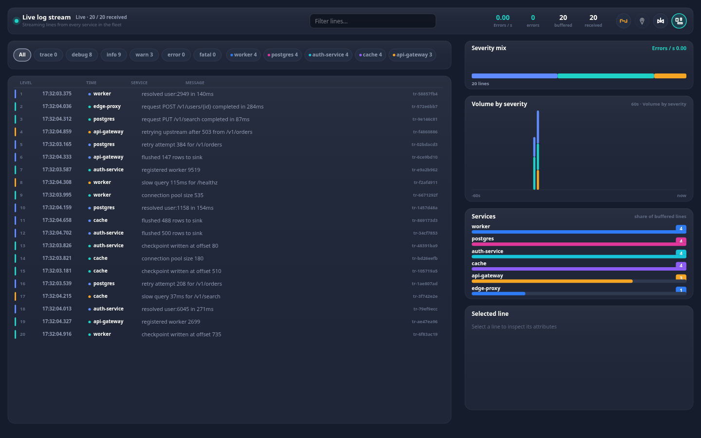

# @widgets/log-stream

Virtualised, filterable live log viewer packaged as the `<log-stream>` web component. Canvas
rendered, so the identical viewer runs on the web, in a Windows WebView2 shell, inside an Android
WebView, in a WKWebView, in React Native and in Flutter.

<p>
  
</p>

## Install & register

```bash
npm install @widgets/log-stream @widgets/core @widgets/render
```

```ts
import '@widgets/log-stream/auto';            // registers <log-stream> (+ <widgets-log-stream>)
// or
import { defineLogStream } from '@widgets/log-stream';
defineLogStream();
```

```html
<!-- one file, no build step, for WebView hosts -->
<script src="./log-stream.global.js"></script>
<log-stream src="wss://logs.example.com/stream" transport="websocket" level="warn"></log-stream>
```

## Configure

```ts
const logs = document.querySelector('log-stream');

logs.setConfig({
  // any of: DataTransport · URL · { transport, url, … } · LogSnapshot · getter · null (mock)
  source: { transport: 'websocket', url: 'wss://logs.example.com/stream' },
  theme: 'dark',
  locale: 'en',
  maxEntries: 5000,        // bounded buffer (default 2000)
  bucketMs: 1000,          // histogram bucket width
  bucketCount: 60,         // histogram window (60s by default)
  rowHeight: 26,
  collapseRepeats: true,   // identical consecutive lines become "×N"
  follow: true,            // pin to the tail as lines arrive
  filters: { levels: ['error', 'fatal'], services: [], query: '', minLevel: 'all' },
  sections: { services: false, histogram: true },
  searchable: true,        // renders a real <input> for the search box
  onAction: (action, payload) => router.push(action),
  onError: (error) => report(error),
});
```

Attributes cover the declarative cases:

```html
<log-stream
  src="wss://logs.example.com/stream"
  transport="websocket"
  theme="dark"
  locale="en"
  level="error,fatal"
  service="api-gateway,worker"
  query="timeout"
  follow="true"
  columns="2"
></log-stream>
```

## API

| Member | Description |
| --- | --- |
| `setConfig(config)` | patch the configuration (restarts the source only when `source` changes) |
| `appendBatch(snapshot)` / `appendLine(entry)` | push lines from a native bridge or your own data layer |
| `clear()` | empty the buffer |
| `refresh()` / `stop()` / `start()` | re-poll, detach, reattach the transport |
| `filter` (get/set) | read or update the active severity/service/query filter |
| `selectedId` | id of the inspected line |
| `copySelection()` | copies the selected line, or the whole filtered view |
| `lineCount`, `viewModel`, `currentLayout`, `hitRegions` | last frame's state |
| events | `widget-snapshot`, `widget-critical`, `widget-select`, `widget-action`, `widget-error`, `widget-render` |

## Interaction

| Input | Behaviour |
| --- | --- |
| wheel / drag | scroll the virtualised list (scrolling back pauses the tail) |
| click a row | inspect it in the detail panel |
| click a severity/service chip | toggle that filter; `All` resets |
| `↑` `↓` / `j` `k` | move the selection (off-screen rows scroll into view) |
| `PageUp` `PageDown` `Home` `End` | page/jump through the list |
| `Space` | pause/resume the tail |
| `/` | focus the search field |
| `Esc` | clear the search or the selection |

## Sections

`toolbar` · `filters` · `stream` (left column) and `severityMix` · `histogram` · `services` ·
`detail` (right column). Any section can be hidden with `config.sections`, and the layout engine
re-flows the rest.

## Payload shapes it understands

```jsonc
// batch
{ "entries": [{ "level": "warn", "service": "api-gateway", "message": "retrying upstream", "timestamp": 1793986240437 }] }

// container style lines, aliases resolved (`severity`, `ts`, `msg`, `container`, `attrs`)
{ "logs": [{ "severity": "ERROR", "ts": 1793986240437, "msg": "write failed", "container": "worker" }] }

// a single streamed line
{ "type": "log", "level": "info", "message": "request completed", "service": "edge" }
```

Timestamps are accepted as seconds, milliseconds, microseconds, nanoseconds or ISO strings; anything
without a message is skipped, so control frames never pollute the view.

## Development

```bash
npm run mock --workspace @widgets/mock-server     # logs on :4310 (/api/v1/logs, /logs/stream)
npm run dev  --workspace @widgets/demo            # playground with a widget switcher
node scripts/serve-bundle.mjs --widget logs       # smoke-test the shipped IIFE bundle
```
