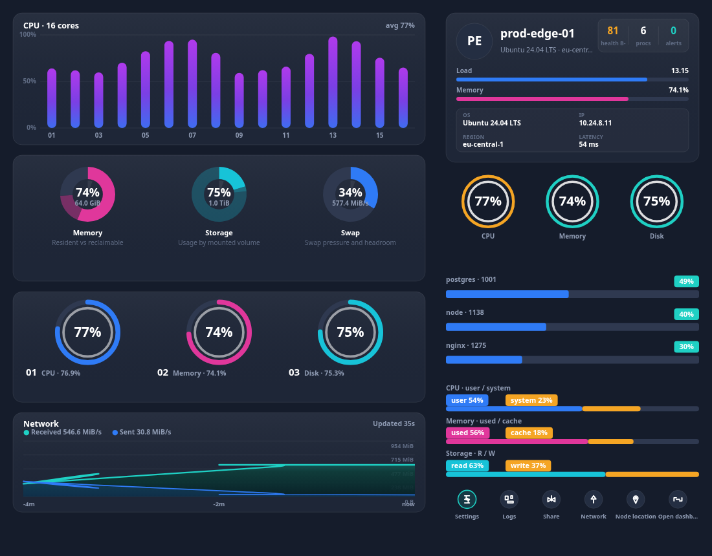

# @widgets/server-monitor

Cross-platform server resource dashboard, packaged as the `<server-monitor>` web component.
Canvas-rendered, so the identical dashboard runs on the web, in a Windows WebView2 shell, inside an
Android WebView, in a WKWebView, in React Native and in Flutter.

<p>
  
</p>

## Install & register

```bash
npm install @widgets/server-monitor @widgets/core
```

```ts
// auto-register on import (also aliases <widgets-server-monitor>)
import '@widgets/server-monitor/auto';

// or register explicitly
import { defineServerMonitor } from '@widgets/server-monitor';
defineServerMonitor();
```

```html
<!-- one file, no build step, for WebView hosts -->
<script src="./server-monitor.global.js"></script>
<server-monitor id="monitor"></server-monitor>
```

## Configure

```ts
const widget = document.getElementById('monitor');

widget.setConfig({
  // any of: DataTransport · URL string · { transport, url, … } · snapshot · getter · null (mock)
  source: { transport: 'websocket', url: 'wss://metrics.example.com/stream' },
  theme: 'dark',                       // 'dark' | 'light' | full ThemeTokens
  themeOverride: { accents: ['#00b3ff', '#ff3ea5', '#22d3ee'] },
  locale: 'en',                        // 'en' | 'fa' | your locale via `messages`
  messages: { 'panel.cpu.title': 'vCPU' },
  columns: 2,                          // force a column count (default: responsive)
  breakpoint: 720,
  thresholds: { cpu: { warning: 65, critical: 85 }, disk: { warning: 78, critical: 90 } },
  sections: { dualBars: false },       // hide any section by id
  historySize: 180,
  tooltips: true,
  onAction: (action, payload) => route(action, payload),
  onError: (error) => report(error),
});
```

Attributes cover the declarative cases:

```html
<server-monitor
  src="wss://metrics.example.com/stream"
  transport="websocket"
  theme="dark"
  locale="en"
  columns="2"
  interval="1500"
  title="Edge fleet"
></server-monitor>
```

## API

| Member | Description |
| --- | --- |
| `setConfig(config)` | patch the configuration (restarts the source only when `source` changes) |
| `setSnapshot(snapshot)` | push a snapshot from a native bridge or your own data layer |
| `refresh()` / `stop()` / `start()` | re-poll, detach, reattach the transport |
| `paint()` | repaint synchronously |
| `snapshot`, `viewModel`, `currentLayout`, `hitRegions`, `hostStatus` | last frame's state |
| events | `widget-snapshot`, `widget-alert`, `widget-action`, `widget-error`, `widget-render` |

## Sections

`cpuBars` · `donuts` · `gauges` · `network` (chart column) and `host` · `badges` · `resourceBars` ·
`dualBars` · `actions` (host column). Any of them can be hidden with `config.sections`, and the
layout engine will re-flow the rest.

## Bundle sizes

| Output | Size |
| --- | --- |
| ESM (`dist/index.js` + shared chunk) | ~80 KB |
| IIFE (`dist/server-monitor.global.js`), minified, core included | ~76 KB |
| Runtime dependencies | none |

## Development

```bash
npm run mock --workspace @widgets/mock-server   # synthetic metrics (HTTP/SSE/WS) on :4310
npm run dev  --workspace @widgets/demo          # playground on :5173
node scripts/serve-bundle.mjs                   # smoke-test the shipped IIFE bundle
```
