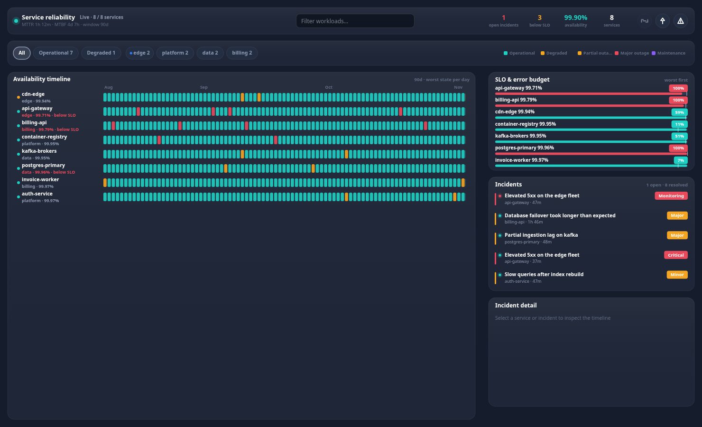

# @widgets/uptime-timeline

Availability heatmap, SLO/error-budget tracking and incident log packaged as the
`<uptime-timeline>` web component. Canvas rendered, so the identical reliability view runs on the
web, in a Windows WebView2 shell, inside an Android WebView, in a WKWebView, in React Native and in
Flutter.

<p>
  
</p>

## Install & register

```bash
npm install @widgets/uptime-timeline @widgets/core @widgets/render
```

```ts
import '@widgets/uptime-timeline/auto';            // registers <uptime-timeline> (+ the widgets- alias)
// or
import { defineUptimeTimeline } from '@widgets/uptime-timeline';
defineUptimeTimeline();
```

```html
<!-- one file, no build step, for WebView hosts -->
<script src="./uptime-timeline.global.js"></script>
<uptime-timeline src="wss://status.example.com/stream" transport="websocket" window="90"></uptime-timeline>
```

## Configure

```ts
const reliability = document.querySelector('uptime-timeline');

reliability.setConfig({
  // any of: DataTransport · URL · { transport, url, … } · UptimeSnapshot · getter · null (mock)
  source: { transport: 'websocket', url: 'wss://status.example.com/stream' },
  theme: 'dark',
  locale: 'en',
  windowDays: 90,        // history kept per service (default 90)
  rowHeight: 30,         // heatmap row height
  maxIncidents: 200,
  filters: { states: ['major_outage', 'degraded'], groups: [], query: '', attentionOnly: false },
  sections: { detail: false },
  searchable: true,
  onAction: (action, payload) => openRunbook(action, payload),
  onError: (error) => report(error),
});
```

Attributes cover the declarative cases:

```html
<uptime-timeline
  src="wss://status.example.com/stream"
  transport="websocket"
  theme="dark"
  locale="en"
  state="major_outage,degraded"
  group="edge,platform"
  query="gateway"
  attention="true"
  columns="2"
></uptime-timeline>
```

## API

| Member | Description |
| --- | --- |
| `setConfig(config)` | patch the configuration (restarts the source only when `source` changes) |
| `appendBatch(snapshot)` | push a status-page snapshot from a native bridge or your own data layer |
| `filter` (get/set) | states, groups, query, `attentionOnly` |
| `selectedId` / `selectedIncident` | inspected service / incident |
| `copyState()` / `clear()` / `refresh()` / `stop()` / `start()` | buffer and transport control |
| `serviceCount`, `incidentCount`, `viewModel`, `currentLayout`, `hitRegions` | last frame state |
| events | `widget-snapshot`, `widget-transition`, `widget-incident`, `widget-select`, `widget-action`, `widget-error`, `widget-render` |

## Interaction

| Input | Behaviour |
| --- | --- |
| wheel / drag | scroll the virtualised heatmap |
| click a service row | inspect it (daily strip + sparkline) |
| click an incident | open its update trail in the inspector |
| click a state/group chip | toggle that filter; `All` resets |
| `↑` `↓` / `PageUp` `PageDown` / `Home` `End` | move the selected row (scrolls it into view) |
| `a` | toggle "needs attention" |
| `/` | focus the search field (hidden below 520 px) |
| `Esc` | clear the selection |

## Sections

`toolbar` · `filters` (full width) then `timeline` (left column) and `slo` · `incidents` · `detail`
(right column). Any section can be hidden with `config.sections`, and the layout engine re-flows the
rest.

## Payload shapes it understands

```jsonc
// canonical
{ "services": [{ "id": "edge/api", "name": "api", "group": "edge", "state": "operational",
  "uptime": 99.95, "sloTarget": 99.9,
  "days": [{ "day": 1790812800000, "state": "operational", "uptime": 100, "incidents": [] }] }],
  "incidents": [{ "id": "i1", "title": "Elevated errors", "severity": "major", "state": "resolved",
    "startedAt": 1790900000000, "resolvedAt": 1790903600000, "services": ["edge/api"],
    "updates": [{ "at": 1790903600000, "state": "resolved", "message": "Recovered" }] }] }

// Statuspage style: component `history` code strings (O/D/P/M/S), `incident_updates`
{ "components": [{ "id": "abc", "name": "API", "status": "Partial Outage", "history": "OOODMO" }],
  "incidents": [{ "name": "Elevated errors", "impact": "critical", "status": "resolved",
    "created_at": "2026-10-20T10:00:00Z", "incident_updates": [{ "status": "resolved", "body": "Fixed" }] }] }
```

Histories are accepted as objects, plain uptime numbers or code strings; availability, error budgets,
MTTR/MTBF and the day-by-day worst state are all derived when the backend does not report them.

## Development

```bash
npm run mock --workspace @widgets/mock-server       # status pages on :4310 (/api/v1/uptime, /uptime/stream)
npm run dev  --workspace @widgets/demo              # playground with a widget switcher
node scripts/serve-bundle.mjs --widget uptime       # smoke-test the shipped IIFE bundle
```
